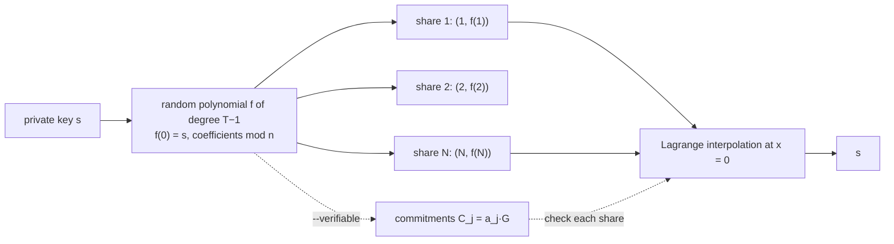

# shamir_scheme

Split a secp256k1 (Bitcoin/Ethereum) private key into *N* shares so that any *T* of them recover it, with optional Feldman verification of every share. C++17 and OpenSSL.

[](https://github.com/catcatcat8/shamir_scheme/actions/workflows/ci.yml)
[](LICENSE)

## Overview

A single private key is a single point of failure: lose it and the funds are gone, leak it and they are stolen. Shamir's secret sharing removes that point by turning the key into *N* shares held in different places. Any *T* shares recover the key, and *T − 1* shares reveal nothing about it. This repository implements the scheme in the scalar field of secp256k1, plus Feldman's verifiable secret sharing (VSS), so that a share holder can check that a share is consistent with the others without seeing them.

The project started as a university course assignment in 2020. The first version had serious cryptographic bugs, listed in [Issues in the 2020 version](#issues-in-the-2020-version). This is a full rewrite with tests and CI.

## How it works



| Module | Purpose |
|---|---|
| [`include/shamir.hpp`](include/shamir.hpp), [`src/shamir.cpp`](src/shamir.cpp) | `split`, `combine`, Feldman `split_verifiable`, `verify_share`, `combine_verified`, share encoding |
| [`include/shamir_keys.hpp`](include/shamir_keys.hpp), [`src/keys.cpp`](src/keys.cpp) | Key generation and validation, public key, EIP-55 Ethereum address |
| [`src/keccak.cpp`](src/keccak.cpp) | Keccak-256 for Ethereum addresses (OpenSSL 3.0 has only SHA3-256) |
| [`src/openssl_util.hpp`](src/openssl_util.hpp) | RAII wrappers for OpenSSL `BIGNUM`, `BN_CTX`, `EC_POINT` |
| [`src/cli.cpp`](src/cli.cpp) | The `shamir` command-line tool |

### Math

All arithmetic is in the prime field $\mathbb{Z}_n$, where $n$ is the order of the secp256k1 group:

$$n = \texttt{FFFFFFFF FFFFFFFF FFFFFFFF FFFFFFFE BAAEDCE6 AF48A03B BFD25E8C D0364141}$$

A valid private key is any $s$ with $1 \le s \le n - 1$, so every key is a field element.

**Split.** Choose random coefficients $a_1, \dots, a_{T-1} \in [1, n-1]$ from OpenSSL's CSPRNG (`BN_priv_rand_range`) and define

$$f(x) = s + a_1 x + a_2 x^2 + \dots + a_{T-1} x^{T-1} \pmod n.$$

Share $i$ is the point $(x_i, y_i) = (i, f(i))$ for $i = 1, \dots, N$, with $1 \le T \le N \le 255$. The polynomial is evaluated with Horner's rule, reducing modulo $n$ after every step.

**Combine.** Given $T$ or more shares with distinct $x_i$, Lagrange interpolation at $x = 0$ gives the secret:

$$s = f(0) = \sum_{i} y_i \, \lambda_i, \qquad \lambda_i = \prod_{j \ne i} \frac{x_j}{x_j - x_i} \pmod n.$$

Division is multiplication by a modular inverse. Because $n$ is prime and the $x_i$ are distinct and non-zero, every $x_j - x_i$ is invertible. The result is exact; there is no floating point anywhere.

**Why T − 1 shares reveal nothing.** For any candidate secret $s'$ and any $T - 1$ shares, there is exactly one polynomial of degree $T - 1$ through the points $(0, s')$ and those shares. Every secret is equally consistent with what the holders see.

**Feldman VSS** (`--verifiable`). The dealer also publishes the commitments $C_j = a_j \cdot G$ for $j = 0, \dots, T-1$, where $G$ is the secp256k1 generator and $a_0 = s$. Since point multiplication is linear, share $(x_i, y_i)$ is consistent with the polynomial if and only if

$$y_i \cdot G = \sum_{j=0}^{T-1} x_i^{\,j} \, C_j.$$

`combine_verified` checks every share this way before combining, and then checks that the recovered secret satisfies $s \cdot G = C_0$. Note that $C_0$ is the public key of $s$.

## Usage

```console
$ ./build/shamir split -t 3 -n 5 --generate --verifiable > shares.txt
Generated a new secp256k1 private key.
public key: 04405b8ecc285edeb3189b2b9a1ddc43b505332e82fd234eca5d75ee4f64b94f58...
address:    0x785fC10E1998a28C2fA3f384FEc68052503270b6

$ cat shares.txt
1:a3c10a75448e1415e8eb5de52ffe0aecf6c0b1a96dc4cd920850c422063580e1
2:471a61470c665deb2751ed4ca0e1bcd84f3250c5d3fe94fb6145167f1baa18b6
3:ba0db8a0303ab8218562b3914dc0ba2efbc3cb296b6762230eeac8d825637ec3
4:fc9b1080b00b22b9031db0b3369b02f241c643ed84b694cd516f7ca0532b71c7
5:0ec268e88bd79db1a082e4b25b709723668ade2b70a38cbe6900d34ad4cbb081
commitments:02405b8ecc285edeb3189b2b9a1ddc43b505332e82fd234eca5d75ee4f64b94f58,0386fa1b...,02c4786b...

$ sed -n '1p;3p;5p;6p' shares.txt | ./build/shamir combine | ./build/shamir address
All shares match the commitments.
public key: 04405b8ecc285edeb3189b2b9a1ddc43b505332e82fd234eca5d75ee4f64b94f58...
address:    0x785fC10E1998a28C2fA3f384FEc68052503270b6
```

Shares 1, 3 and 5 recovered a key with the same address. (This is a throwaway key generated for the example.)

| Command | What it does |
|---|---|
| `shamir split -t T -n N [--generate] [--verifiable]` | Reads a hex key from stdin, or generates one. Prints shares (`x:y`) and, with `--verifiable`, a `commitments:` line. Key info goes to stderr. |
| `shamir combine [--commitments LIST] [SHARE...]` | Recovers the key. Reads shares from stdin if none are given. With commitments, rejects any invalid share. |
| `shamir verify --commitments LIST [SHARE...]` | Prints `valid` / `INVALID` per share; exits with 1 if any share is invalid. |
| `shamir address` | Reads a hex key from stdin and prints its public key and Ethereum address. |

Private keys are read only from stdin, never from arguments, so they do not end up in shell history or in the process list.

### Library

```cpp
#include "shamir.hpp"
#include "shamir_keys.hpp"

shamir::Scalar key = shamir::generate_private_key();
auto [shares, commitments] = shamir::split_verifiable(key, /*threshold=*/3, /*count=*/5);

bool ok = shamir::verify_share(shares[0], commitments);
shamir::Scalar recovered = shamir::combine_verified({shares[0], shares[2], shares[4]}, commitments);
```

## Security considerations

This is an educational implementation. It has not been audited. To protect real funds, use a well-reviewed library or a hardware-backed solution.

- **Plain mode is not verifiable.** Without `--verifiable`, `combine` cannot detect a wrong, corrupted or mixed-up share. It returns a different key without an error. The same happens with fewer than *T* shares, because the threshold is not stored in the shares. Feldman mode detects both cases.
- **The dealer is trusted.** The dealer sees the key while splitting it. Feldman VSS lets share holders check that the dealer gave them consistent shares, but it does not hide the key from the dealer.
- **The key is rebuilt in one place.** `combine` puts the whole key in the memory of one machine. This is not threshold signing (TSS/MPC), where the key never exists in one place.
- **Feldman commitments are public information about the key.** $C_0 = s \cdot G$ is the public key. The commitments hide the coefficients only computationally (discrete logarithm), unlike plain Shamir, which is information-theoretically secure.
- **Coefficients are drawn from $[1, n - 1]$, not $[0, n - 1]$.** This keeps the polynomial at full degree and every commitment a valid point. The resulting bias is $1/n \approx 2^{-256}$ per coefficient.
- **Side channels.** OpenSSL's general `BIGNUM` modular arithmetic is not guaranteed to be constant-time. The Lagrange coefficients depend only on the public $x_i$, but the multiplications by the secret shares do not run in guaranteed constant time.
- **Memory hygiene is best effort.** Secrets are wiped on destruction (`OPENSSL_cleanse`, `BN_clear_free`, `BN_CTX_secure_new`), but copies may remain in places the program does not control: I/O buffers, swap, core dumps. A key typed into a terminal is echoed to the screen.
- **Store shares apart.** Anyone holding *T* shares holds the key.

### Issues in the 2020 version

The original code is kept in the git history ([`shamir.cpp` at 09751d3](https://github.com/catcatcat8/shamir_scheme/blob/09751d3/shamir.cpp)). It had these problems, all fixed in this version:

1. **No finite field.** The polynomial was evaluated over the integers with `BN_mul` and `BN_add`, with no reduction modulo a prime ([L84–L99](https://github.com/catcatcat8/shamir_scheme/blob/09751d3/shamir.cpp#L84-L99)). Over the integers a share leaks information about the secret. For example, $y_1 = s + a_1$ with non-negative $a_1$ means $s \le y_1$.
2. **Floating-point recovery.** Lagrange interpolation used `cpp_dec_float<100>` and corrected the rounding error by adding 1 to the result ([L146–L176](https://github.com/catcatcat8/shamir_scheme/blob/09751d3/shamir.cpp#L146-L176)).
3. **Undefined behaviour in coefficient generation.** Sixteen random bytes were read as a NUL-terminated C string ([L111–L114](https://github.com/catcatcat8/shamir_scheme/blob/09751d3/shamir.cpp#L111-L114)). This read past the end of the buffer, and when the first random byte was `0x00` (probability 1/256), the coefficient became the constant `sha256("")`.
4. **Wrong curve.** The key was called a "curve25519 ECDSA" key ([L50–L58](https://github.com/catcatcat8/shamir_scheme/blob/09751d3/shamir.cpp#L50-L58)). Curve25519 is used for X25519 and Ed25519, not ECDSA, and the key was a SHA-256 hash that was not checked against any curve order.
5. **No input validation.** The program read `argv[1]` without checking `argc` ([L186](https://github.com/catcatcat8/shamir_scheme/blob/09751d3/shamir.cpp#L186)), accepted any `N` and `T`, and did not check for duplicate shares. It also leaked memory and had no tests.

## Getting started

### Requirements

- CMake 3.16 or newer and a C++17 compiler (tested with GCC 11 locally; CI uses the GCC and Clang shipped with Ubuntu 24.04)
- OpenSSL 1.1.1 or newer, with secp256k1 enabled (the upstream default)
- Internet access on the first build, to fetch GoogleTest (pinned by SHA-256)

On Debian or Ubuntu:

```bash
sudo apt-get install build-essential cmake libssl-dev
```

### Build and test

```bash
cmake -S . -B build
cmake --build build -j
ctest --test-dir build --output-on-failure
```

The test suite contains 41 GoogleTest cases and one end-to-end CLI test. It covers:

- known-answer tests;
- recovery from every *T*-subset and failure for every (*T* − 1)-subset;
- the edge cases *T* = 1, *T* = *N* and *N* = 255;
- invalid input;
- a property test on 1000 random keys;
- Feldman tampering tests;
- Keccak-256 vectors and known Ethereum addresses.

Options: `-DSHAMIR_SANITIZE=ON` (ASan + UBSan), `-DSHAMIR_WERROR=ON`, `-DSHAMIR_BUILD_TESTS=OFF`. CI builds with GCC in Release mode and with Clang plus sanitizers.

## Project structure

```
.
├── include/
│   ├── shamir.hpp          # public API: split / combine / Feldman VSS
│   └── shamir_keys.hpp     # key generation, public key, Ethereum address
├── src/
│   ├── shamir.cpp          # field arithmetic, Lagrange, Feldman
│   ├── keys.cpp            # secp256k1 key helpers
│   ├── keccak.cpp/.hpp     # Keccak-256
│   ├── openssl_util.*      # RAII wrappers for OpenSSL types
│   └── cli.cpp             # `shamir` command-line tool
├── tests/                  # GoogleTest suites and cli_test.sh
├── .github/workflows/ci.yml
└── CMakeLists.txt
```

## Context

I wrote the first version in October 2020 as a university course project. In 2026 I rewrote it with correct finite-field arithmetic, Feldman VSS, tests and CI. The [issues section](#issues-in-the-2020-version) above doubles as a short audit of my own early code.

## License

[MIT](LICENSE)
